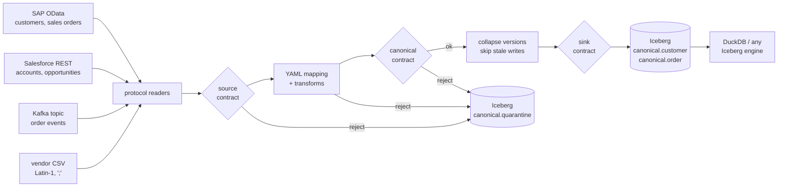

# UnifiedIntegrationLayer

[](https://github.com/Jain-Karan/unified-integration-layer/actions/workflows/ci.yml)


A declarative integration layer that lands SAP, Salesforce, Kafka and vendor flat files in one
canonical customer/order model on **Apache Iceberg**. Each source is a YAML mapping, not a
pipeline. Contract tests guard both sides of the model, and every rejected record goes to a
quarantine table with the reason it was rejected.

- **One mapping per source** (`src/uil/mappings/*.yaml`): a protocol reader, a source contract
  (required fields, patterns), and a field-by-field mapping built from small reusable
  transforms (`sap_datetime`, German decimal commas, Salesforce 15→18-character IDs,
  Latin-1 files with preamble lines, epoch millis, naive local dates → UTC).
- **Canonical model** in Pydantic v2 with an Arrow schema per entity. Country codes are
  checked against the 249 assigned ISO 3166-1 codes, money is `decimal(18,2)`, and every
  timestamp must be UTC-aware.
- **Iceberg sink** via PyIceberg: upserts keyed on the canonical ID. Superseded versions within
  a batch are collapsed first, and writes older than the stored version are skipped, so
  redelivered and late events can't roll state back. Lineage columns
  (`_source`, `_batch_id`, `_ingested_at`) are on every row.
- **Contracts on both sides:** a source contract before mapping, the canonical model after
  it, and a sink contract that refuses to write if someone has altered the Iceberg table out
  of band.
- **Quarantine, not crash:** records that fail any check go to `canonical.quarantine` with the
  raw record and a categorized reason (source contract / transform / canonical contract).



## Quickstart

```bash
pip install -e ".[dev]"
uil generate --out data/feeds                 # synthetic SAP / Salesforce / Kafka / vendor feeds
uil ingest --feeds data/feeds --lake data/lake
uil query "select _source, count(*) from customer group by 1" --lake data/lake
uil query "select error, count(*) from quarantine group by 1 order by 2 desc" --lake data/lake
pytest
```

The local catalog is SQLite and the warehouse is a directory, so everything runs without
infrastructure. The tables are standard Iceberg (Parquet data files plus metadata).
[`docs/engines.md`](docs/engines.md) shows how to point Snowflake or Databricks at them.

## Adding a source

A new source is a YAML file. Here is the whole mapping for the Kafka order topic:

```yaml
source: kafka.orders
domain: retail
entity: order
feed: retail/kafka_orders
reader: {type: kafka, topic: orders}
contract:
  required: [order_id, customer_ref, order_ts, currency, amount_cents, status, event_ts]
fields:
  order_id:    {from: order_id, transform: [{prefix: "retail:"}]}
  customer_id: {from: customer_ref, transform: [{prefix: "retail:"}]}
  order_date:  {from: order_ts, transform: [epoch_ms, date]}
  currency:    {from: currency, transform: [upper]}
  amount:      {from: amount_cents, transform: [cents]}
  status:      {from: status, transform: [{map: {table: {open: open, shipped: shipped, cancelled: cancelled}}}]}
  updated_at:  {from: event_ts, transform: [epoch_ms]}
```

The mapping is checked when it loads: an unknown entity, or a field that isn't in the canonical
model, fails immediately, not at 2 a.m. on the first bad record. A source quirk that isn't
covered yet becomes one new transform in `transforms.py` with a test, and every later source
gets it for free.

## Results on the synthetic estate

The repo has no real SAP or Salesforce data. `uil generate` builds a synthetic estate across
**three domains** (manufacturing on SAP, B2B sales on Salesforce, retail on Kafka plus a
distributor's CSV). It reproduces the formats these sources actually send, injects defects at
a 3% rate, and writes a ground-truth file. Results for seed 7 (`benchmarks/quality.py`, with
the Kafka topic consumed in 500-event micro-batches):

| | |
|---|---|
| records read, 6 sources | 6,083 |
| injected defects caught in quarantine | **158 / 158** |
| good records quarantined by mistake | **0** |
| orders in the lake with the correct final status and amount | **4,070 / 4,070** |
| Kafka versions collapsed within a batch / stale writes skipped | 196 / 341 |
| orders kept that reference a quarantined customer | 130 (reported, not dropped) |

Without the stale-write guard (issue #2), the same run ends with **334 of 1,447 retail orders
(23.1%)** in an older state than their latest event. Without the in-batch collapse (issue #1),
the first micro-batch with a redelivery aborts entirely.

### How much code a source takes

To make the comparison fair, `baselines/` contains the straightforward hand-written pipeline
each source would need without the framework. Tests prove that every baseline leaves the lake
**identical** to its YAML mapping, rejects included. Counting logical lines (no blanks,
comments or docstrings; `benchmarks/loc.py`):

| source | bespoke pipeline | YAML mapping |
|---|---:|---:|
| SAP customers | 60 | 17 |
| SAP sales orders | 66 | 15 |
| Salesforce accounts | 77 | 15 |
| Salesforce opportunities | 80 | 15 |
| Kafka orders | 72 | 15 |
| vendor CSV customers | 58 | 17 |
| **mean per source** | **68.8** | **15.7 (−77.2%)** |

The framework itself is 422 lines (readers, transforms, mapping engine, pipeline). That count
includes live SAP/Salesforce paging and a Kafka consumer the baselines don't have. So, honestly:
**at these six sources the framework is still 24.9% more code in total (516 vs 413 lines). It
breaks even at 8 sources**, and after that each source costs about 16 lines instead of about
69. The other payoff is that quirks are fixed once: the stale-write and ISO-country fixes
below each landed in one place, not in six scripts.

## Issues found while building it

| issue | what happened | fix |
|---|---|---|
| #1 | PyIceberg's `upsert` refuses a frame with duplicate keys. One Kafka redelivery, or an order's `created` and `shipped` events in the same batch, aborted the whole batch. | Collapse to the newest version per key (event time, then log position) before writing. PR #4 |
| #2 | A redelivered `order_created` arriving in a later micro-batch than `shipped` rolled the order back to `open`. Upsert overwrote unconditionally. | Read the stored `updated_at` for the batch's keys and skip older writes, counted as `stale`. PR #5 |
| #3 | The vendor file's placeholder country `XX` passed the `^[A-Z]{2}$` check and landed in the customer table. | Validate against the assigned ISO 3166-1 codes; reserved `UK`/`EU` are rejected too. PR #6 |

## Layout

```
src/uil/
  canonical.py      Pydantic models, Arrow schemas, ISO country list
  transforms.py     reusable field transforms (the source quirks live here)
  mapping.py        YAML mapping loader, source contracts, record mapping
  readers.py        sap_odata, salesforce, kafka, flatfile (local landing or live)
  pipeline.py       read → contract → map → collapse → quarantine / upsert
  lake.py           PyIceberg catalog, sink contract, stale-write guard, DuckDB queries
  synthetic.py      synthetic SAP / Salesforce / Kafka / vendor feeds + ground truth
  mappings/*.yaml   one per source
baselines/          bespoke pipelines, for the code-size comparison
benchmarks/         loc.py, quality.py; results in reports/
tests/contracts/    source and sink contract tests (own CI job)
```

## Limits

- Only DuckDB and PyIceberg have been run against these tables. The Snowflake and Databricks
  steps in `docs/engines.md` follow those products' documented Iceberg support, but they
  haven't been tested here.
- The live SAP, Salesforce and Kafka readers are thin and are not exercised in CI. Tests read
  captured payloads in the same formats.
- Upserts are per batch and row-level; there's no compaction or partitioning strategy yet.
  That's fine at this scale, not at billions of rows.
- Cross-source identity (the same company in SAP and Salesforce) is not resolved. Canonical
  IDs are namespaced per source system.

## License

MIT
